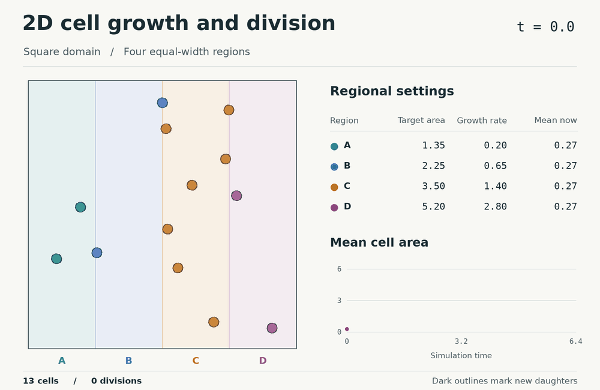
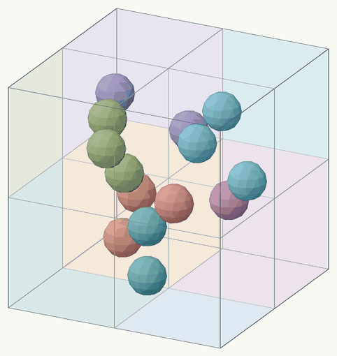
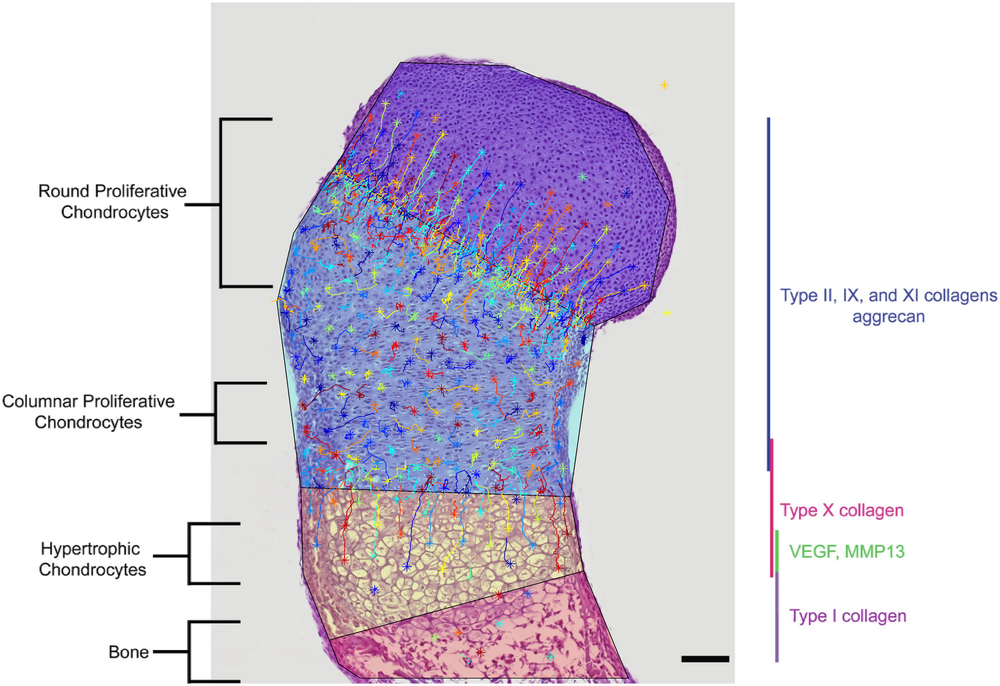
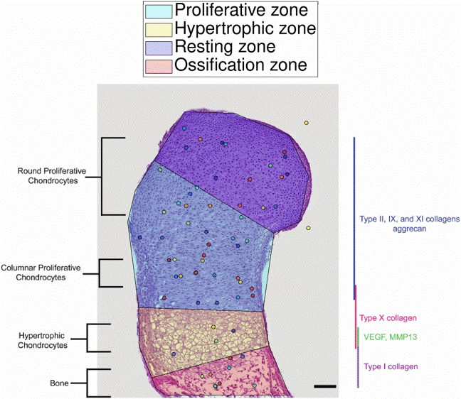

# vertex-rl

2D/3D vertex model with RL training on cellular action model

## Synthetic simulations

| 2D | 3D |
| :---: | :---: |
|  |  |

## Cartilage simulation

| Trajectories | Live simulation |
| :---: | :---: |
|  |  |
